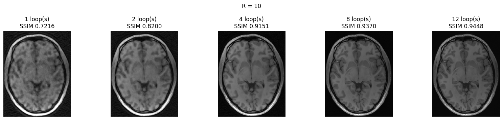

# One Block Is Enough: LoopMR for Accelerated MRI Reconstruction

[Paper (arXiv:2611.14947)](https://arxiv.org/abs/2611.14947) · [Weights](https://huggingface.co/hym97/loopmri)

LoopMR reuses a single Restormer block at every iteration of an unrolled reconstruction. Besides the current image estimate, the
block receives data-consistency inputs and latent images, and each iteration ends with a soft data-consistency step in k-space.
The model uses 12 iterations, 4 latents and 5 adjacent slices (adjacent time frames or weightings on CMRxRecon2023), with sensitivity
maps from PromptMR+'s sensitivity map estimator (SME). It has 10.27M parameters (block 8.40M, SME 1.87M).

## Demo



**One block, twelve passes.** This is a CC359 test slice at ×10 after 1, 2, 4, 8 and 12 iterations (called loops in the code and in
the figure). Every iteration applies the same 8.40M-parameter block. The zero-filled image of this slice has an SSIM of 0.7426, and the
12th iteration reaches 0.9448.

[`notebooks/demo.ipynb`](notebooks/demo.ipynb) loads the released weights and reconstructs this slice at ×5 and ×10, next to the fully
sampled image and the error map. It then shows the image after 1, 2, 4, 8 and 12 iterations and the SSIM and PSNR after each of the 12.
The notebook is committed with its outputs, so it can be read on GitHub without running anything. Running it needs the prepared CC359
data and works on a GPU or a CPU.

## Setup

Python 3.10 with torch 2.8 (CUDA 12.8), fastmri 0.3.0, einops, timm, h5py, numpy, scipy, scikit-image, pyyaml, matplotlib and
huggingface_hub. Prepare the data as in [`data_prep/README.md`](data_prep/README.md). Everything goes below `data/` in the repo.

## Training

| config | dataset | training steps |
|---|---|---|
| `configs/cc359_rs5_fd.yaml` | Calgary-Campinas (CC359) brain, 47 training volumes, ×5 / ×10 | 146,640 |
| `configs/knee5_rs5_fd.yaml` | fastMRI knee, 159 training volumes, ×4 / ×8 | 100,000 |
| `configs/cmr23_rs5_fd.yaml` | CMRxRecon2023 cine and mapping, P001-P100, ×4 / ×8 / ×10 | 466,596 |

```bash
python -m loopmri.train --config configs/cc359_rs5_fd.yaml
```

```bash
python -m loopmri.train --config configs/cmr23_rs5_fd.yaml
```

The knee model starts its SME from a pre-fit to plain calibration maps (the config uses the released one). To make your own:

```bash
python scripts/prefit_sens.py --config configs/knee5_rs5_fd.yaml --out runs/knee5_sens_prefit
```

```bash
python -m loopmri.train --config configs/knee5_rs5_fd.yaml --set model.sens_init=runs/knee5_sens_prefit/sens_plain.pt
```

A run writes `runs/<run_name>/` and resumes from its last checkpoint. On Slurm, `slurm/train.sbatch` requeues itself at the time limit:
`CONFIG=configs/cc359_rs5_fd.yaml sbatch --gres=gpu:1 slurm/train.sbatch`.

## Evaluation

```bash
python -m loopmri.evaluate --ckpt weights/cc359_rs5_fd_146k.pt --out runs/eval/cc359.json
```

```bash
python -m loopmri.evaluate --ckpt weights/knee5_rs5_fd_100k.pt --out runs/eval/knee.json
```

```bash
python -m loopmri.evaluate --ckpt weights/cmr23_rs5_fd_466k.pt --out runs/eval/cmr23.json
```

Each dataset is scored with its official protocol: CC359 on PromptMR+'s 10 test volumes with the Calgary-Campinas challenge metric,
fastMRI knee on the 40 test volumes with the fastMRI metrics, and CMRxRecon2023 on the 76 test files (P101-P120), every file at ×4,
×8 and ×10 as in the challenge, with the challenge's ranking protocol. The weights are downloaded from Hugging Face on first use. A training run's `runs/<run_name>/ckpt_best.pt` works
in place of the weights. The paired tests against the baselines (two-sided Wilcoxon signed-rank test) take the evaluation output:

```bash
python scripts/paired_test.py --ours runs/eval/cc359.json
```

`results/` holds the per-volume numbers behind the table below: the outputs of the three commands above for the released weights
(`loopmr_cc359.json`, `loopmr_knee.json`, `loopmr_cmr23.json`) and the baselines' numbers (`baselines_per_volume.json`). The paired
tests can therefore be rerun without the data or a GPU:

```bash
python scripts/paired_test.py --ours results/loopmr_cc359.json
```

### PromptMR+

The PromptMR+ numbers below come from the same script, protocols and metrics:

```bash
python -m loopmri.evaluate --ckpt weights/promptmr_plus/cc359_promptmr_plus_released.pt --out runs/eval/cc359_promptmr_plus.json
```

```bash
python -m loopmri.evaluate --ckpt weights/promptmr_plus/knee5_promptmr_plus_100k.pt --out runs/eval/knee_promptmr_plus.json
```

```bash
python -m loopmri.evaluate --ckpt weights/promptmr_plus/cmr23_promptmr_plus_466k.pt --out runs/eval/cmr23_promptmr_plus.json
```

On CC359 these are the authors' released weights. On first use the code downloads their checkpoint from
[huggingface.co/hellopipu/PromptMR](https://huggingface.co/hellopipu/PromptMR) and converts it, after checking its sha256 and its
network hyper-parameters. The authors' knee and CMRxRecon2023 weights were trained on other data (fastMRI's full knee training set, and
CMRxRecon2023 P001-P120, which includes the test patients). On these two datasets PromptMR+ was therefore trained by us with the
authors' settings on the same data and schedule as LoopMR, and its weights are downloaded from our Hugging Face repository like
LoopMR's. The configs are in `configs/promptmr_plus/`. `loopmri/promptmr_plus.py` runs the authors' network (vendored unchanged) with
its denoisers in bf16, as in our experiments. The paired tests take the two evaluation outputs:

```bash
python scripts/paired_test.py --a runs/eval/cc359.json --b runs/eval/cc359_promptmr_plus.json --names LoopMR PromptMR+
```

## Results

PSNR (dB) / SSIM of the released weights, as `loopmri.evaluate` prints them, for LoopMR and PromptMR+:

| dataset | R | LoopMR | PromptMR+ |
|---|---|---|---|
| CC359 brain | ×5 | 37.45 / 0.9528 | 37.28 / 0.9513 |
| | ×10 | 35.12 / 0.9377 | 34.83 / 0.9346 |
| fastMRI knee | ×4 | 40.44 / 0.9424 | 40.34 / 0.9410 |
| | ×8 | 37.54 / 0.9161 | 37.39 / 0.9138 |
| CMRxRecon2023 heart | ×4 | 41.93 / 0.9800 | 41.66 / 0.9788 |
| | ×8 | 37.24 / 0.9559 | 36.82 / 0.9524 |
| | ×10 | 36.00 / 0.9485 | 35.55 / 0.9440 |

LoopMR is better than PromptMR+ in PSNR and SSIM with p < 0.01 in every row (two-sided Wilcoxon signed-rank test over volumes, or
over patients on CMRxRecon2023). It is better on every test volume (CC359, knee) and on every patient at ×8 and ×10 (CMRxRecon2023).
At ×4 it is better on 19 of the 20 patients in SSIM and 18 in PSNR. The CC359 and knee numbers were computed on an H100 and the
CMRxRecon2023 numbers on an A100. The block runs in bf16, so on another GPU type PSNR can differ by a few hundredths of a dB per
volume and about 0.01 dB in these means (the paper's CMRxRecon2023 numbers were computed on an H100, 37.25 dB at ×8).

## Weights

[huggingface.co/hym97/loopmri](https://huggingface.co/hym97/loopmri) (CC BY-NC 4.0), LoopMR's three models and, below
`promptmr_plus/`, our knee and CMRxRecon2023 PromptMR+ models. Without internet access on the GPU machine, download them beforehand
with `hf download hym97/loopmri --local-dir weights`, and make PromptMR+'s CC359 weights with
`python -c "from loopmri.hub import weights_path; weights_path('weights/promptmr_plus/cc359_promptmr_plus_released.pt')"`. 

## Citation

```bibtex
@article{he2026loopmr,
  title   = {One Block Is Enough: {LoopMR} for Accelerated {MRI} Reconstruction},
  author  = {He, Yimeng and Xie, Yibin and Zheng, Yi and Gao, Yifan and Wang, Lixia and Hsu, Yin-Chen and Wang, Yufeng and Lu, Meng and Li, Debiao and Huang, Xiuzhen},
  journal = {arXiv preprint arXiv:2611.14947},
  year    = {2026}
}
```

## Licence

The code in this repository is released under the Creative Commons Attribution-NonCommercial 4.0 International licence (CC BY-NC 4.0,
see [`LICENSE`](LICENSE)), except the two vendored folders, which keep their own licences. The vendored PromptMR+ code
(`loopmri/vendor/promptmr_plus`) is under Rutgers' non-commercial research licence and the vendored SDUM code (`loopmri/vendor/sdum`)
is Apache-2.0. Our weights are CC BY-NC 4.0 as well. PromptMR+'s CC359 weights are the authors' and come under their licence.
